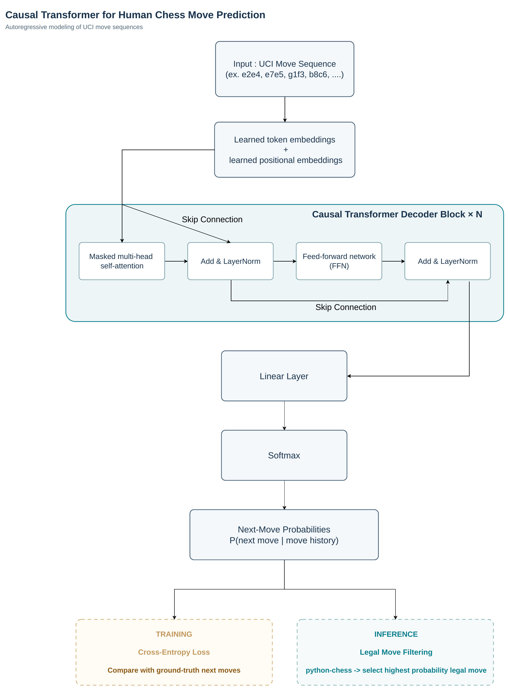

# Human Chess Move Prediction with a Causal Transformer

CSC413 Final Project — Mateja Cerovina, Sungmin Cho, Tanush Lahir, Abdul Hadi

We train a decoder-only (causal) transformer to predict the next move a human player
(rated 2100–2299, 10–15 minute rapid games) would make, given the sequence of moves
played so far. We compare it against an LSTM/GRU baseline using top-1 and top-3 accuracy.

## Repository Structure

```
data/
  raw/            Lichess .pgn.zst archives (not committed)
  processed/      vocabulary and train/val/test token files
src/              data pipeline, models, training, evaluation
notebooks/        dataset analysis and plots
demo/             playable demo
checkpoints/      saved model weights (not committed)
results/
  figures/        architecture figure, training curves, result plots
  metrics/        accuracy results
```

## Setup

```bash
python -m venv .venv
source .venv/bin/activate        # Windows: .venv\Scripts\activate
pip install -r requirements.txt
```

## How to Run

TODO: commands for download → preprocess → train → evaluate → demo

## Model



TODO: short description, number of parameters

## Data

- **Source:** [Lichess Open Database](https://database.lichess.org/#standard_games), October 2016 – March 2017
- **Filters:** both players rated 2100–2299, 10–15 min initial time, 0–10 s increment, no BOT accounts
- **Size:** 44,626 games, ~3.4M moves, vocabulary of 1,896 UCI moves
- **Split:** 60 / 20 / 20 by game (seed 42)

TODO: summary statistics, data transformation

## Training

TODO: training curves, hyperparameters and how they were chosen

## Results

TODO: top-1 / top-3 accuracy (transformer vs. baseline), results by rating bucket,
one good and one bad test example, analysis of rare moves (promotions, en passant)

## Ethical Considerations

TODO

## Authors and Contributions

| Member | Contributions |
|---|---|
| Mateja Cerovina | TODO |
| Sungmin Cho | TODO |
| Tanush Lahir | TODO |
| Abdul Hadi | TODO |
